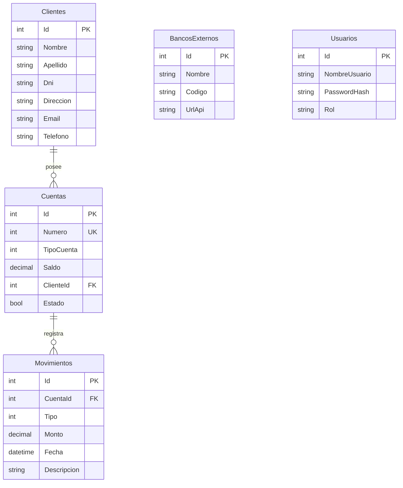

# BankLink – API REST Bancaria

Trabajo Práctico Final de **Programación II**. API RESTful para un sistema bancario interno que gestiona **clientes, cuentas y movimientos**, administra **bancos externos** y ejecuta **transferencias interbancarias** consumiendo la API de otro banco.

**Tecnologías:** .NET 10 (ASP.NET Core Web API) · Entity Framework Core · SQLite · autenticación JWT · Swagger.

## Contenido

1. [Cómo ejecutarlo](#cómo-ejecutarlo)
2. [Autenticación](#autenticación)
3. [Modelo de datos (DER)](#modelo-de-datos-der)
4. [Resumen de endpoints](#resumen-de-endpoints)
5. [Detalle de los endpoints principales](#detalle-de-los-endpoints-principales)
6. [Integración con otros bancos](#integración-con-otros-bancos)
7. [Consistencia transaccional](#consistencia-transaccional)
8. [Códigos de estado HTTP](#códigos-de-estado-http)
9. [Estructura del proyecto](#estructura-del-proyecto)

## Cómo ejecutarlo

**Requisito:** [.NET 10 SDK](https://dotnet.microsoft.com/download).

1. Entrar a la carpeta del proyecto:

   ```bash
   cd BankLink
   ```

2. Crear el archivo `.env` a partir de `.env.example` y completar las dos claves: la que firma los tokens JWT (mínimo 32 caracteres) y la API key que se usa entre bancos:

   ```
   Jwt__Key=una-clave-secreta-larga-de-al-menos-32-caracteres
   ApiExterna__ApiKey=mi-clave-secreta-de-prueba-123
   ```

3. Ejecutar la API:

   ```bash
   dotnet run --launch-profile http
   ```

La API queda disponible en `http://localhost:5021`. La documentación interactiva (Swagger) está en `http://localhost:5021/swagger` y la especificación OpenAPI en `http://localhost:5021/swagger/v1/swagger.json`.

El perfil `http` escucha en todas las interfaces de red (`http://0.0.0.0:5021`), por lo que otros equipos de la red pueden consumir la API usando la IP de la máquina (por ejemplo `http://192.168.0.10:5021`). Es lo que necesita otro banco para llamar a `recibir`.

> La base de datos SQLite (`banklink.db`) viene incluida en el proyecto. Si se elimina, se vuelve a crear con `dotnet ef database update` (requiere la herramienta `dotnet-ef`).

## Autenticación

La API usa **JWT Bearer** para los usuarios. Todos los endpoints requieren token, salvo los de `Auth` y `POST /api/Transferencias/recibir`, que consume otro banco y se protege con una **API key** (ver más abajo).

1. Registrar un usuario con `POST /api/Auth/register`.
2. Iniciar sesión con `POST /api/Auth/login`: devuelve un `token` que vence a los 30 minutos.
3. Enviar el token en cada pedido: `Authorization: Bearer <token>`. En Swagger, usar el botón **Authorize** y pegar solo el token.

El registro crea usuarios con rol `Usuario`; el rol `Administrador` se asigna directamente en la tabla `Usuarios`. Los endpoints marcados como **Administrador** responden `403` a los demás roles, y los que requieren token responden `401` si falta o es inválido.

**API key entre bancos.** `POST /api/Transferencias/recibir` exige el encabezado `X-API-Key` con la clave configurada en `ApiExterna:ApiKey` (en `appsettings.json` o en la variable `ApiExterna__ApiKey` del `.env`). Si falta o no coincide responde `401`. BankLink envía esa misma clave en el encabezado `X-API-Key` cuando llama a la API de otro banco.

## Modelo de datos (DER)



- **Clientes** 1 — N **Cuentas**: cada cuenta pertenece a un cliente existente. El número de cuenta (`Cuentas.Numero`) es único.
- **Cuentas** 1 — N **Movimientos**: cada movimiento pertenece a una cuenta.
- Borrado en cascada: al eliminar un cliente se eliminan sus cuentas y, al eliminar una cuenta, sus movimientos.
- **BancosExternos** guarda los bancos con los que se puede operar. Se consulta por `Codigo` al enviar una transferencia (no hay clave foránea).
- **Usuarios** guarda las credenciales del login y no se relaciona con las demás tablas.

Valores de los enumerados (se guardan como número y la API los muestra como texto):

| Campo | Valores |
|---|---|
| `Cuentas.TipoCuenta` | `0` AHORRO · `1` CORRIENTE |
| `Cuentas.Estado` | `true` activa · `false` inactiva |
| `Movimientos.Tipo` | `0` DEPOSITO · `1` RETIRO · `2` TRANSFERENCIA_ENVIADA · `3` TRANSFERENCIA_RECIBIDA |

## Resumen de endpoints

Acceso: **Público** (sin token) · **Token** (usuario autenticado) · **Administrador** (token de un usuario con rol Administrador) · **API Key** (encabezado `X-API-Key`).

| Método | URL | Descripción | Acceso |
|---|---|---|---|
| `POST` | `/api/Auth/register` | Registrar un usuario | Público |
| `POST` | `/api/Auth/login` | Iniciar sesión y obtener el token | Público |
| `GET` | `/api/Clientes` | Listar clientes | Token |
| `GET` | `/api/Clientes/{id}` | Obtener un cliente | Token |
| `POST` | `/api/Clientes` | Crear un cliente | Token |
| `PUT` | `/api/Clientes/{id}` | Actualizar un cliente | Token |
| `DELETE` | `/api/Clientes/{id}` | Eliminar un cliente | Administrador |
| `GET` | `/api/Cuentas` | Listar cuentas | Token |
| `GET` | `/api/Cuentas/{id}` | Obtener una cuenta | Token |
| `POST` | `/api/Cuentas` | Crear una cuenta | Token |
| `PUT` | `/api/Cuentas/{id}` | Actualizar el tipo y el estado de una cuenta | Token |
| `DELETE` | `/api/Cuentas/{id}` | Eliminar una cuenta | Administrador |
| `POST` | `/api/Cuentas/{id}/deposito` | Depositar dinero en una cuenta | Token |
| `POST` | `/api/Cuentas/{id}/retiro` | Retirar dinero de una cuenta | Token |
| `GET` | `/api/cuentas/{cuentaId}/Movimientos` | Consultar los movimientos de una cuenta | Token |
| `GET` | `/api/Bancos` | Listar bancos externos | Token |
| `GET` | `/api/Bancos/{id}` | Obtener un banco externo | Token |
| `POST` | `/api/Bancos` | Registrar un banco externo | Token |
| `PUT` | `/api/Bancos/{id}` | Actualizar un banco externo | Token |
| `DELETE` | `/api/Bancos/{id}` | Eliminar un banco externo | Token |
| `POST` | `/api/Transferencias/enviar` | Enviar una transferencia a otro banco | Token |
| `POST` | `/api/Transferencias/recibir` | Recibir una transferencia de otro banco | API Key |

## Detalle de los endpoints principales

Los ejemplos usan datos ficticios y los textos de error son los que devuelve la API. Los demás endpoints (listar, obtener por id, actualizar y eliminar) siguen la misma convención REST y se ven en el resumen de arriba.

### 1. Registro e inicio de sesión

**`POST /api/Auth/register`** · Público

| Parámetro | Ubicación | Tipo | Descripción |
|---|---|---|---|
| `usuario` | body | texto | Nombre de usuario |
| `password` | body | texto | Contraseña |

```json
{
  "usuario": "juan",
  "password": "MiClave123"
}
```

Respuesta `200 OK`:

```json
{
  "id": 4,
  "nombreUsuario": "juan"
}
```

Error: `409 Conflict` → `Ese usuario ya existe.`

**`POST /api/Auth/login`** · Público · mismo body que el registro.

Respuesta `200 OK`:

```json
{
  "token": "eyJhbGciOiJIUzI1NiIsInR5cCI6IkpXVCJ9..."
}
```

Error: `401 Unauthorized` → `Credenciales inválidas.`

### 2. Crear cliente

**`POST /api/Clientes`** · Token

| Parámetro | Ubicación | Tipo | Descripción |
|---|---|---|---|
| `nombre` | body | texto | Nombre |
| `apellido` | body | texto | Apellido |
| `dni` | body | texto | DNI (no puede repetirse) |
| `direccion` | body | texto | Dirección |
| `email` | body | texto | Correo electrónico |
| `telefono` | body | texto | Teléfono |

```json
{
  "nombre": "Juan",
  "apellido": "Pérez",
  "dni": "30123456",
  "direccion": "Av. Siempre Viva 742",
  "email": "juan.perez@mail.com",
  "telefono": "3434001122"
}
```

Respuesta `201 Created` (con el encabezado `Location: http://localhost:5021/api/Clientes/1`):

```json
{
  "id": 1,
  "nombre": "Juan",
  "apellido": "Pérez",
  "dni": "30123456",
  "direccion": "Av. Siempre Viva 742",
  "email": "juan.perez@mail.com",
  "telefono": "3434001122"
}
```

Error: `400 Bad Request` → `Ya existe un cliente con DNI 30123456.`

### 3. Crear cuenta

**`POST /api/Cuentas`** · Token

| Parámetro | Ubicación | Tipo | Descripción |
|---|---|---|---|
| `numero` | body | entero | Número de cuenta (único) |
| `tipoCuenta` | body | texto | `AHORRO` o `CORRIENTE` |
| `clienteId` | body | entero | Id de un cliente existente |
| `estado` | body | booleano | `true` activa, `false` inactiva (opcional, por defecto `true`) |

```json
{
  "numero": 1001,
  "tipoCuenta": "AHORRO",
  "clienteId": 1,
  "estado": true
}
```

Respuesta `201 Created` (la cuenta siempre se crea con saldo 0):

```json
{
  "id": 1,
  "numero": 1001,
  "tipoCuenta": "AHORRO",
  "saldo": 0,
  "clienteId": 1,
  "estado": true
}
```

Errores:
- `404 Not Found` → `No existe un cliente con ID 99.`
- `400 Bad Request` → `El número de cuenta 1001 ya está registrado.`

### 4. Depósito

**`POST /api/Cuentas/{id}/deposito`** · Token

| Parámetro | Ubicación | Tipo | Descripción |
|---|---|---|---|
| `id` | URL | entero | Id de la cuenta |
| `monto` | body | número | Monto a depositar (mayor a 0) |
| `descripcion` | body | texto | Detalle del movimiento (opcional) |

```json
{
  "monto": 50000,
  "descripcion": "Depósito en ventanilla"
}
```

Respuesta `200 OK`. Actualiza el saldo y registra un movimiento `DEPOSITO` en una única transacción:

```json
{
  "saldo": 50000,
  "mensaje": "Depósito exitoso."
}
```

Errores:
- `400 Bad Request` → `El monto debe ser mayor a cero.`
- `400 Bad Request` → `Cuenta inválida o inactiva.` (también si la cuenta no existe)
- `500 Internal Server Error` → `Error procesando el depósito.`

### 5. Retiro

**`POST /api/Cuentas/{id}/retiro`** · Token · mismos parámetros que el depósito.

```json
{
  "monto": 20000,
  "descripcion": "Retiro por cajero"
}
```

Respuesta `200 OK`. Verifica que el saldo alcance, lo descuenta y registra un movimiento `RETIRO` en una única transacción:

```json
{
  "saldo": 30000,
  "mensaje": "Retiro exitoso."
}
```

Errores:
- `400 Bad Request` → `Saldo insuficiente.`
- `400 Bad Request` → `El monto debe ser mayor a cero.`
- `400 Bad Request` → `Cuenta inválida o inactiva.` (también si la cuenta no existe)
- `500 Internal Server Error` → `Error procesando el retiro.`

### 6. Consultar movimientos de una cuenta

**`GET /api/cuentas/{cuentaId}/Movimientos`** · Token

| Parámetro | Ubicación | Tipo | Descripción |
|---|---|---|---|
| `cuentaId` | URL | entero | Id de la cuenta |

Respuesta `200 OK`, del movimiento más reciente al más antiguo (la fecha está en UTC):

```json
[
  {
    "id": 2,
    "cuentaId": 1,
    "tipo": "RETIRO",
    "monto": 20000,
    "fecha": "2026-11-18T15:12:03.7712345",
    "descripcion": "Retiro por cajero"
  },
  {
    "id": 1,
    "cuentaId": 1,
    "tipo": "DEPOSITO",
    "monto": 50000,
    "fecha": "2026-11-18T15:10:22.4567891",
    "descripcion": "Depósito en ventanilla"
  }
]
```

Error: `404 Not Found` → `La cuenta no existe`

### 7. Registrar un banco externo

**`POST /api/Bancos`** · Token

| Parámetro | Ubicación | Tipo | Descripción |
|---|---|---|---|
| `nombre` | body | texto | Nombre del banco |
| `codigo` | body | texto | Código de identificación (único) |
| `urlApi` | body | texto | URL base de la API del otro banco |

```json
{
  "nombre": "Banco Ejemplo",
  "codigo": "0002",
  "urlApi": "http://192.168.0.20:5049"
}
```

Respuesta `201 Created`:

```json
{
  "id": 1,
  "nombre": "Banco Ejemplo",
  "codigo": "0002",
  "urlApi": "http://192.168.0.20:5049"
}
```

Error: `400 Bad Request` → `Ya existe un banco registrado con el código '0002'.`

### 8. Transferencia enviada

**`POST /api/Transferencias/enviar`** · Token

| Parámetro | Ubicación | Tipo | Descripción |
|---|---|---|---|
| `cuentaOrigenId` | body | entero | Id de la cuenta de BankLink que envía el dinero |
| `codigoBancoDestino` | body | texto | Código de un banco registrado en `/api/Bancos` |
| `numeroCuentaDestino` | body | entero | Número de la cuenta en el banco destino |
| `monto` | body | número | Monto a transferir (mayor a 0) |
| `descripcion` | body | texto | Detalle de la transferencia (opcional) |

```json
{
  "cuentaOrigenId": 1,
  "codigoBancoDestino": "0002",
  "numeroCuentaDestino": 55,
  "monto": 15000,
  "descripcion": "Pago de alquiler"
}
```

Proceso, todo dentro de una transacción:

1. Valida el monto, el banco destino y la cuenta de origen (activa y con saldo suficiente).
2. Descuenta el saldo y registra un movimiento `TRANSFERENCIA_ENVIADA` en la cuenta de origen.
3. Notifica al banco destino llamando a su API (ver [Integración con otros bancos](#integración-con-otros-bancos)).
4. Si el banco destino responde con éxito (2xx) confirma la transacción; si no, la revierte.

Respuesta `200 OK`:

```json
{
  "mensaje": "Transferencia enviada con éxito."
}
```

Errores:
- `400 Bad Request` → `Monto inválido.`
- `400 Bad Request` → `Banco destino no registrado.`
- `400 Bad Request` → `Cuenta de origen inválida o inactiva.`
- `400 Bad Request` → `Saldo insuficiente.`
- `502 Bad Gateway` → el banco destino rechazó la transferencia o no se pudo conectar:

```json
{
  "error": "Error de comunicación con el banco externo.",
  "detalle": "El banco destino rechazó la transferencia (401): ..."
}
```

- `500 Internal Server Error` → fallo inesperado, la transacción se revierte:

```json
{
  "error": "Error procesando la transferencia. Transacción revertida.",
  "detalle": "..."
}
```

En todos los casos de error el saldo de la cuenta de origen queda sin cambios.

### 9. Transferencia recibida

**`POST /api/Transferencias/recibir`** · API Key

Es el endpoint que el banco externo consume para avisar que envió dinero a una cuenta de BankLink. No usa token de usuario: se protege con el encabezado `X-API-Key`.

| Parámetro | Ubicación | Tipo | Descripción |
|---|---|---|---|
| `X-API-Key` | encabezado | texto | Clave compartida entre bancos (`ApiExterna:ApiKey`) |
| `numeroCuentaDestino` | body | entero | Número (`Numero`) de la cuenta de BankLink que recibe el dinero |
| `codigoBancoOrigen` | body | texto | Código del banco que envía |
| `monto` | body | número | Monto recibido (mayor a 0) |
| `descripcion` | body | texto | Detalle de la transferencia (opcional) |

```json
{
  "numeroCuentaDestino": 1001,
  "codigoBancoOrigen": "0002",
  "monto": 5000,
  "descripcion": "Transferencia recibida"
}
```

Ejemplo con `curl` (Swagger no tiene un campo para este encabezado, por eso se prueba con `curl` o Postman):

```bash
curl -X POST http://localhost:5021/api/Transferencias/recibir \
  -H "Content-Type: application/json" \
  -H "X-API-Key: <clave>" \
  -d '{"numeroCuentaDestino":1001,"codigoBancoOrigen":"0002","monto":5000,"descripcion":"Transferencia recibida"}'
```

Aumenta el saldo de la cuenta y registra un movimiento `TRANSFERENCIA_RECIBIDA` en una única transacción. Respuesta `200 OK`:

```json
{
  "mensaje": "Transferencia recibida e imputada con éxito.",
  "cuentaDestinoNumero": 1001,
  "monto": 5000
}
```

Errores:
- `400 Bad Request` → `Monto inválido.`
- `400 Bad Request` → `Cuenta destino no encontrada o inactiva.`
- `401 Unauthorized` → falta el encabezado `X-API-Key` o la clave no coincide:

```json
{
  "mensaje": "API key faltante o inválida."
}
```

- `500 Internal Server Error` → fallo inesperado, la transacción se revierte:

```json
{
  "error": "Error al imputar la transferencia recibida.",
  "detalle": "..."
}
```

## Integración con otros bancos

Cada banco con el que se opera se registra con `POST /api/Bancos`, indicando su código y la URL base de su API.

**Transferencia enviada (BankLink → otro banco).** Al ejecutar `POST /api/Transferencias/enviar`, BankLink hace el siguiente pedido a la API del banco destino:

```http
POST {urlApi del banco destino}/api/transferencias/recibir
Content-Type: application/json
X-API-Key: <clave configurada en ApiExterna:ApiKey>
```

```json
{
  "numeroCuentaDestino": 55,
  "codigoBancoOrigen": "BANKLINK",
  "monto": 15000,
  "descripcion": "Pago de alquiler"
}
```

Si la `urlApi` registrada ya termina en `/recibir`, se usa tal cual. La transferencia se confirma solo si el otro banco responde con un código 2xx.

**Pruebas con un banco simulado.** Como recomienda el enunciado, las transferencias se probaron contra un banco simulado con Postman. En la base de ejemplo está registrado como `BancoPostman` (código `0002`, `http://localhost:4500`).

**Transferencia recibida (otro banco → BankLink).** El otro banco llama a `POST /api/Transferencias/recibir` con el mismo formato JSON y el encabezado `X-API-Key` con la clave acordada entre ambos bancos. BankLink acredita la cuenta cuyo número (`Numero`) coincide con `numeroCuentaDestino`.

## Consistencia transaccional

El depósito, el retiro, la transferencia enviada y la transferencia recibida se ejecutan dentro de una **transacción de base de datos**: la actualización del saldo y el registro del movimiento se confirman juntos o no se confirma ninguno.

En la transferencia enviada la transacción incluye además la llamada al banco destino: si este no confirma la operación, se hace *rollback* y el saldo de la cuenta de origen queda intacto.

## Códigos de estado HTTP

| Código | Cuándo se devuelve |
|---|---|
| `200 OK` | Operación exitosa: consultas, actualizaciones, depósito, retiro, transferencias, registro y login |
| `201 Created` | Cliente, cuenta o banco creado (incluye el encabezado `Location`) |
| `204 No Content` | Eliminación exitosa |
| `400 Bad Request` | Datos inválidos o regla de negocio incumplida: monto menor o igual a 0, saldo insuficiente, cuenta inactiva, banco no registrado, DNI, número de cuenta o código de banco duplicado al crear |
| `401 Unauthorized` | Falta el token, es inválido o está vencido; credenciales incorrectas en el login; API key faltante o inválida en `recibir` |
| `403 Forbidden` | El usuario no tiene el rol Administrador |
| `404 Not Found` | El recurso solicitado no existe |
| `409 Conflict` | El usuario ya existe (registro) |
| `500 Internal Server Error` | Error interno; la transacción se revierte |
| `502 Bad Gateway` | El banco externo rechazó la transferencia o no se pudo conectar |

## Estructura del proyecto

```
BankLink/
├── Controllers/   Endpoints de la API (Auth, Clientes, Cuentas, Movimientos, Bancos, Transferencias)
├── Services/      Lógica de negocio y transacciones
├── Interfaces/    Contratos de los servicios
├── DTOs/          Objetos de entrada de los endpoints
├── Models/        Entidades: Cliente, Cuenta, Movimiento, Banco, Usuario
├── Enums/         TipoCuenta, TipoMovimiento
├── Context/       BankLinkContext (Entity Framework Core)
├── Migrations/    Migraciones de la base de datos
└── Program.cs     Configuración: JWT, Swagger, inyección de dependencias
```
